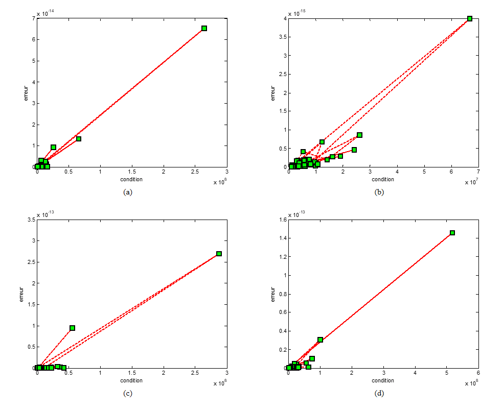

# Orthogonalisation de Schmidt — comparaison de deux méthodes

**施密特正交化：两种算法的数值比较**

[Français](#version-française) · [中文](#中文版)

Projet réalisé en binôme par **LI Yicong** et **CHEN Nuo**, 2022.

本项目由**李毅聪**与**陈诺**两人合作完成（2022 年）。

---

## 中文版

### 项目简介

Gram–Schmidt 正交化有两个理论上等价的版本：

- **经典版本（CGS）**：每个向量依次减去它在所有已构造正交向量上的投影；
- **修正版本（MGS）**：每做一次投影就立即更新当前向量，再进入下一次投影。

精确算术下两者得到同一个标准正交基；浮点运算下结果不同。本项目用 MATLAB 实现两个算法，
用 C 独立复现，并用病态矩阵与随机矩阵实验量化两者的差异、解释误差的来源。

### 方法

1. 对同一矩阵分别运行 CGS 与 MGS，得到标准正交基 `Q_CGS`、`Q_MGS`；
2. 以 Frobenius 范数 `‖Q_CGS − Q_MGS‖_F` 作为两种算法的误差度量；
3. 构造含极小量 `ε` 的病态矩阵，放大舍入误差的影响；
4. 随机生成 100 个 `100×100`、`cond > 10⁶` 的矩阵，绘制"条件数 — 误差"曲线，重复多次实验。

### 结果

| 矩阵 | 规模 | `cond(A)` | `‖Q_CGS − Q_MGS‖_F` |
|---|---|---|---|
| `A = [[1,2,3],[2,−1,2],[1,1,2]]` | 3×3 | 53.9413 | 5.9242×10⁻³¹（数值上为 0） |
| `B = [[1,1,1],[ε,0,0],[0,ε,0],[0,0,ε]]`，`ε = 10⁻¹⁰` | 4×3 | 1.7321×10¹⁰ | 0.2679 |



*100 个随机病态矩阵上的实验结果：横轴为条件数，纵轴为两种算法的误差；四个子图对应四次独立运行。*

### 结论

- 条件数较小时，两种算法结果在数值上几乎一致；
- 条件数极大时（列向量接近线性相关），CGS 的误差被逐步放大，MGS 的误差被限制在每次投影内部；
- 几何上，列向量接近平行时，投影的相消导致有效数字大量丢失，残余误差在后续步骤中累积；
- 因此 MGS 的数值稳定性优于 CGS，这也是数值计算库普遍采用 MGS 的原因。

### C 实现

`projects/gram-schmidt/src/main.c` 将算法写成可执行程序，包含内积、单位化两个子函数，
按列完成正交化与归一化。

```bash
gcc -O2 -Wall -o gs projects/gram-schmidt/src/main.c -lm
printf "3 3\n1 2 3\n2 -1 2\n1 1 2\n" | ./gs
```

输入为列数、行数，以及逐行给出的矩阵元素；当前实现要求方阵，最大 `100×100`。

```
  0.408248  0.759072  0.507093
  0.816497 -0.552052  0.169031
  0.408248  0.345033 -0.845154
```

输出与 MATLAB 的 `Q` 一致。Xcode 工程 `matrix.xcodeproj` 与源码同目录，工程内源码组指向
`src/`。

### 仓库结构

```
.
├── README.md                     # 项目说明（中法双语）
├── docs/
│   └── LEARNING.md               # 算法背景、相关理论、代码笔记
├── projects/
│   └── gram-schmidt/
│       ├── README.md             # 项目细节
│       ├── src/main.c            # C 实现
│       ├── matrix.xcodeproj/     # Xcode 工程
│       └── report/
│           ├── rapport-TP-2022.pdf   # 报告全文（法语）
│           └── figures/              # 报告插图与 MATLAB 输出
└── archive/                      # 报告早期版本
```

### 报告

法语报告包含理论推导、两版 MATLAB 实现、误差度量与几何解释：
`projects/gram-schmidt/report/rapport-TP-2022.pdf`

---

## Version française

### Présentation

L'orthogonalisation de Gram-Schmidt existe en deux variantes théoriquement équivalentes :

- **version classique (CGS)** : chaque vecteur est orthogonalisé par rapport à l'ensemble des
  vecteurs déjà construits ;
- **version modifiée (MGS)** : chaque projection est appliquée immédiatement, le vecteur mis à jour
  servant à la projection suivante.

En arithmétique exacte, les deux versions produisent la même base orthonormée ; en arithmétique
flottante, les résultats diffèrent. Le projet implémente les deux algorithmes sous MATLAB, en donne
une version C autonome, et quantifie l'écart à l'aide de matrices mal conditionnées et de tirages
aléatoires.

### Démarche

1. Calcul des bases `Q_CGS` et `Q_MGS` pour une même matrice ;
2. mesure de l'écart par la norme de Frobenius `‖Q_CGS − Q_MGS‖_F` ;
3. construction d'une matrice mal conditionnée contenant un paramètre `ε` très petit, afin
   d'amplifier les erreurs d'arrondi ;
4. génération de 100 matrices aléatoires `100×100` de conditionnement `cond > 10⁶`, puis tracé des
   courbes « conditionnement — erreur », répété plusieurs fois.

### Résultats

| Matrice | Taille | `cond(A)` | `‖Q_CGS − Q_MGS‖_F` |
|---|---|---|---|
| `A = [[1,2,3],[2,−1,2],[1,1,2]]` | 3×3 | 53,9413 | 5,9242×10⁻³¹ (soit 0 en pratique) |
| `B = [[1,1,1],[ε,0,0],[0,ε,0],[0,0,ε]]`, `ε = 10⁻¹⁰` | 4×3 | 1,7321×10¹⁰ | 0,2679 |


*100 matrices mal conditionnées : conditionnement en abscisse, écart entre les deux versions en
ordonnée ; les quatre panneaux correspondent à quatre exécutions indépendantes.*

### Conclusions

- pour un conditionnement faible, les deux algorithmes coïncident numériquement ;
- pour un conditionnement très élevé (colonnes presque liées), l'erreur de CGS est amplifiée d'une
  étape à l'autre, tandis que celle de MGS reste confinée à chaque projection ;
- géométriquement, des vecteurs presque parallèles provoquent une cancellation dans le calcul des
  projections et une perte de chiffres significatifs, dont le résidu se propage ensuite ;
- MGS est donc numériquement plus stable, ce qui explique son usage dans les bibliothèques de
  calcul scientifique.

### Implémentation en C

`projects/gram-schmidt/src/main.c` traduit l'algorithme en programme exécutable : deux fonctions
auxiliaires (produit scalaire, normalisation), puis orthogonalisation et normalisation colonne par
colonne.

```bash
gcc -O2 -Wall -o gs projects/gram-schmidt/src/main.c -lm
printf "3 3\n1 2 3\n2 -1 2\n1 1 2\n" | ./gs
```

L'entrée donne le nombre de colonnes, le nombre de lignes, puis les coefficients ligne par ligne ;
l'implémentation actuelle traite des matrices carrées de taille maximale `100×100`.

```
  0.408248  0.759072  0.507093
  0.816497 -0.552052  0.169031
  0.408248  0.345033 -0.845154
```

La sortie coïncide avec la matrice `Q` obtenue sous MATLAB. Le projet Xcode `matrix.xcodeproj` est
placé à côté des sources, son groupe de fichiers pointant vers `src/`.

### Organisation du dépôt

```
.
├── README.md                     # présentation du projet (bilingue)
├── docs/
│   └── LEARNING.md               # contexte algorithmique, théorie, notes de code
├── projects/
│   └── gram-schmidt/
│       ├── README.md             # détails du projet
│       ├── src/main.c            # implémentation C
│       ├── matrix.xcodeproj/     # projet Xcode
│       └── report/
│           ├── rapport-TP-2022.pdf   # rapport complet (français)
│           └── figures/              # figures du rapport et sorties MATLAB
└── archive/                      # versions préliminaires du rapport
```

### Rapport

Le rapport en français contient la théorie, les deux implémentations MATLAB, la mesure des erreurs
et l'interprétation géométrique :
`projects/gram-schmidt/report/rapport-TP-2022.pdf`
